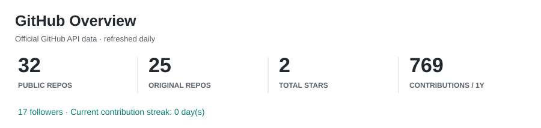
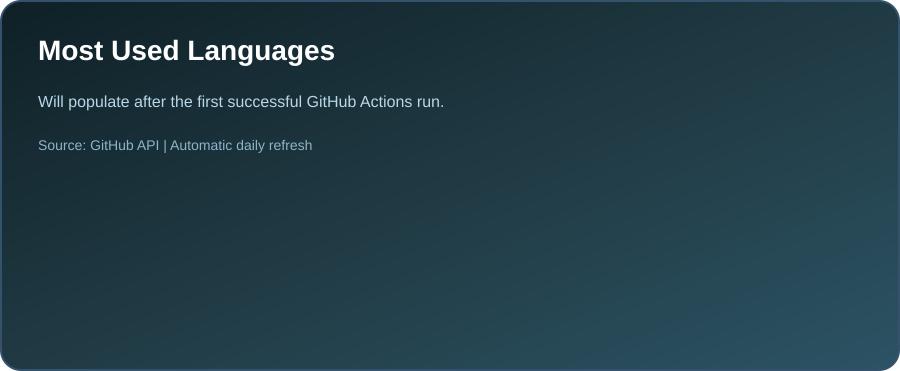
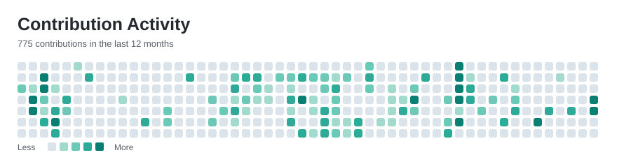

<!-- Kim Subin / GitHub profile -->

---

## 👋 About Me

Hi, I'm **Kim Subin**, a Computer Science student at **Keimyung University**.

I am an aspiring **Backend / Full-Stack Developer** interested in building practical web services with AI-integrated features.  
I have experience developing projects using **Spring Boot, React, Next.js, Flask, PostgreSQL, and AWS**, and I enjoy turning ideas into real, usable services.

I am especially interested in **real-time collaboration systems, workspace-based service architecture, database design, API development, and AI-powered web applications**.

---

## 🧠 Tech Stack

### Backend

### Frontend

### Database & Infra

### Tools

---

## 🚀 Main Projects

### 🧩 ONit — Workspace Collaboration Platform
> A workspace-based collaboration platform with real-time communication and idea management features.

- Developed backend features using **Spring Boot, PostgreSQL, WebSocket/STOMP, and AWS**.
- Implemented real-time chat for workspace collaboration.
- Designed APIs for creating, updating, moving, and deleting idea boxes on an infinite canvas.
- Built coordinate-saving logic and participated in backend service architecture design.

**[Source Code — ONit Backend & MSA](https://github.com/qlsl1198/capstone_msa)**

---

### 🎓 KMU Scholarship Chatbot
> A GPT-powered chatbot that helps students find scholarship information more easily.

- Developed with **Python, Flask, OpenAI API, and JSON**.
- Structured scholarship data for question-based responses.
- Designed response logic to help students access relevant scholarship information.

---

### 📚 EduPulse — AI Tutor Learning Platform
> A learning platform that provides AI tutor features based on course content and learning flow.

- Developed with **Next.js, TypeScript, Prisma, and PostgreSQL**.
- Designed a course and lesson management structure.
- Implemented AI tutor features to support learning.

**[Source Code — EduPulse](https://github.com/qlsl1198/vibe-contest)**

---

### 🎬 Movie Explorer
> A movie information web application for exploring movie data through a simple UI.

- Built with **JavaScript, HTML, CSS, Node.js, and Express**.
- Implemented movie listing, filtering, and detail views with TMDB API data.
- Practiced API data handling, dynamic rendering, and responsive UI design.

**[Source Code — Movie Explorer](https://github.com/qlsl1198/movie-explorer)**

---

## 📌 Currently Interested In

- Backend Development with Spring Boot
- REST API Design and Database Modeling
- Real-time Communication with WebSocket / STOMP
- AI-integrated Web Services
- Cloud Deployment with AWS and Vercel
- Collaborative Workspace Systems
- Practical Full-Stack Service Development

---

## 📊 GitHub Stats

## 🧩 Activity

Statistics update from the official GitHub API via [GitHub Actions](./.github/workflows/profile-stats.yml). Percentages reflect repository code bytes, not skill level.

---

## 🐍 Contribution Snake

---

## 🏆 Certifications

- Engineer Information Processing (정보처리기사)
- SQLD (SQL 개발자)
- ADsP (데이터분석 준전문가)
- OPIc Intermediate Mid 2 (오픽 IM2)
- Computer Specialist in Spreadsheet & Database Level 2 (컴퓨터활용능력 2급)
- COS Pro Level 2 Python (COS Pro 2급 Python)
- DIAT Gold Master (디지털정보활용능력 골드마스터)

---

## 📫 Contact

---

### ⭐ Thank you for visiting my profile!

